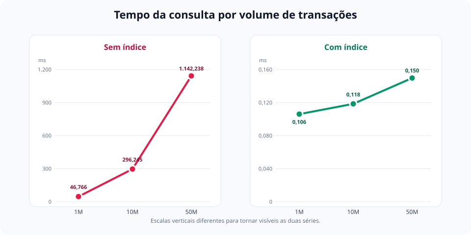

# 07 — Benchmark de escala: 1M vs. 10M vs. 50M

Agora, vamos verificar como a consulta de extrato do caso 1 se comporta conforme a tabela cresce de 1 milhão para 50 milhões de transações.

**Cenário:** PostgreSQL 18.4, cache quente, conta `47`, período de 01/01/2025 a 01/04/2025 e tabelas com o mesmo formato de `transactions`.

| Linhas | Tamanho da tabela | Sem índice | Blocos acessados | Com índice | Blocos acessados | Tamanho do índice |
|---:|---:|---:|---:|---:|---:|---:|
| 1 milhão | 90 MB | 32,864 ms | 11.458 | 0,014 ms | 4 | 30 MB |
| 10 milhões | 895 MB | 271,706 ms | 114.578 | 0,012 ms | 8 | 301 MB |
| 50 milhões | 4.478 MB | 936,632 ms | 573.017 | 0,015 ms | 10 | 1.504 MB |



## A consulta

Utilizamos a mesma consulta do caso 1:

```sql
select
    *
from
    benchmark_transactions
where
    account_id = 47
    and created_at between '2025-01-01' and '2025-04-01'
order by
    created_at desc;
```

Para cada volume, a consulta foi executada primeiro sem índice e depois com o índice correto:

```sql
create index idx_benchmark_transactions_account_created_at
    on benchmark_transactions (account_id, created_at);
```

O cache foi aquecido antes de coletar cada plano com `EXPLAIN (ANALYZE, BUFFERS)`.

## Como as amostras foram criadas

A amostra de 1 milhão utiliza o primeiro milhão de transações da base. Depois, ela é completada com as demais linhas para chegar aos 10 milhões.

Para chegar aos 50 milhões sem alterar a base original, as 10 milhões de transações são repetidas quatro vezes em uma tabela `UNLOGGED`, deslocando o `id` e o `created_at` de cada cópia:

```sql
insert into benchmark_transactions
select
    t.id + (copies.copy_number * 10000000),
    t.account_id,
    t.counterparty_id,
    t.amount,
    t.direction,
    t.status,
    t.category,
    t.created_at + (copies.copy_number * interval '1 microsecond')
from
    transactions t
cross join
    generate_series(1, 4) as copies(copy_number);
```

O deslocamento de microssegundos é importante. Sem ele, as cinco cópias teriam a mesma combinação de `account_id, created_at`, e o PostgreSQL poderia deduplicar essas chaves nas folhas da B tree. Isso produziria um índice artificialmente menor do que um índice com 50 milhões de chaves distintas.

## Sem índice

Com 1 milhão de linhas, o banco utilizou um `Parallel Seq Scan`, acessou 11.458 blocos e levou 32,864 ms:

```text
Parallel Seq Scan on benchmark_transactions  (actual time=24.417..25.725 rows=0.33 loops=3)
  Filter: ((created_at >= '2025-01-01 00:00:00+00'::timestamptz)
       AND (created_at <= '2025-04-01 00:00:00+00'::timestamptz)
       AND (account_id = 47))
  Rows Removed by Filter: 333333
  Buffers: shared hit=11458
Execution Time: 32.864 ms
```

Com 10 milhões, o mesmo plano acessou 114.578 blocos e levou 271,706 ms. Com 50 milhões, chegou a 573.017 blocos e 936,632 ms:

```text
Parallel Seq Scan on benchmark_transactions  (actual time=435.044..912.558 rows=8.33 loops=3)
  Filter: ((created_at >= '2025-01-01 00:00:00+00'::timestamptz)
       AND (created_at <= '2025-04-01 00:00:00+00'::timestamptz)
       AND (account_id = 47))
  Rows Removed by Filter: 16666658
  Buffers: shared hit=15957 read=557060
Execution Time: 936.632 ms
```

Repare que o crescimento dos blocos é praticamente linear. A tabela de 50 milhões possui 50 vezes mais linhas que a de 1 milhão e exigiu exatamente 50 vezes mais blocos: 573.017 contra 11.458.

Esse é o problema de uma consulta que depende de `Seq Scan`: cada nova transação aumenta o trabalho necessário, mesmo que pertença a outra conta ou esteja fora do período pesquisado.

## Com índice

Com o índice `(account_id, created_at)`, o plano muda para `Index Scan Backward`:

```text
Index Scan Backward using idx_benchmark_transactions_account_created_at on benchmark_transactions
  (actual time=0.006..0.010 rows=25.00 loops=1)
  Index Cond: ((account_id = 47)
           AND (created_at >= '2025-01-01 00:00:00+00'::timestamptz)
           AND (created_at <= '2025-04-01 00:00:00+00'::timestamptz))
  Index Searches: 1
  Buffers: shared hit=10
Execution Time: 0.015 ms
```

O tempo ficou entre 0,012 ms e 0,015 ms nas três escalas. A pequena diferença está dentro da variação normal de uma execução tão curta.

Isso não significa que buscar em uma B tree tenha custo constante. A travessia cresce em O(log n), mas a altura da árvore muda muito devagar. Entre 1 milhão e 50 milhões de linhas, o executor precisou acessar apenas 4, 8 e 10 blocos para encontrar e devolver as transações correspondentes.

## O que mudou

Sem índice, multiplicar a tabela por 50 multiplicou por 50 a quantidade de blocos acessados e levou a consulta de 32,864 ms para 936,632 ms.

Com o índice, o banco não percorre as transações das outras contas. Ele desce diretamente até `account_id = 47`, encontra o início do período e lê somente as entradas necessárias. Mesmo com 50 milhões de linhas e uma tabela de aproximadamente 4,4 GB, a consulta levou 0,015 ms.

O benchmark completo pode ser reproduzido com [`benchmark_scale.sql`](../benchmarks/benchmark_scale.sql). A tabela criada por ele é descartável e removida ao final da execução.
